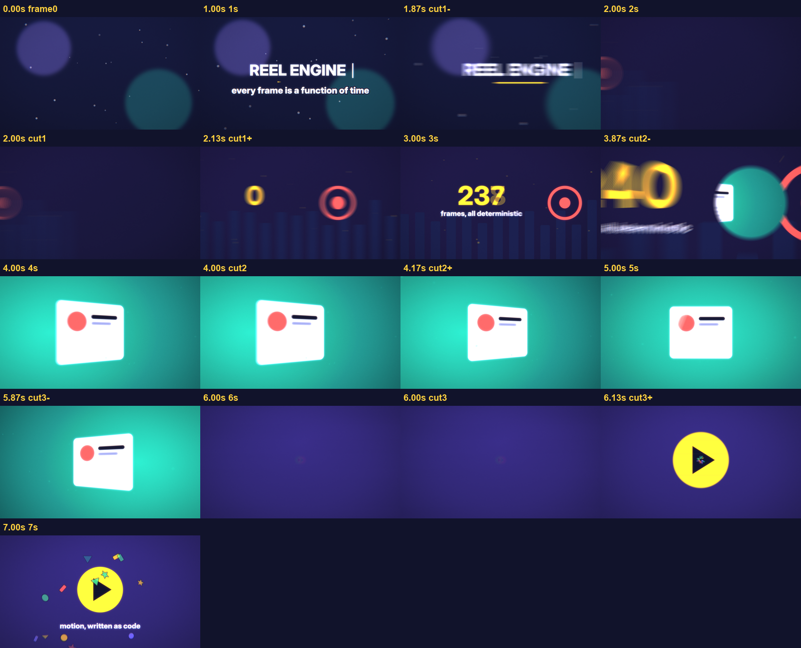
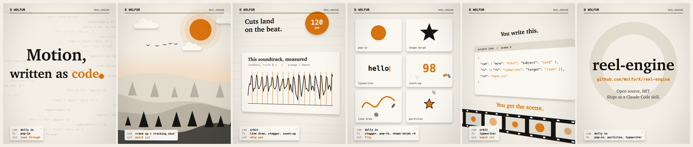

# reel-engine

Motion graphics as code. Write each scene as SVG that is a pure function of time; reel-engine moves a real 3D camera
through its depth layers, runs named cuts and element animations, renders every frame with true motion blur and a film
post pass, mixes music and synthesised sound effects, and encodes an MP4.



The 8-second demo above is [`examples/demo`](examples/demo) ([video](examples/demo/demo.mp4)): a dolly in with a
typewriter title, a whip pan, a tracking shot over a count-up, a zoom through a ring, an orbit around a card that keystones
in perspective, a glitch cut and a pop-in with particles. All of it is named in [`project.json`](examples/demo/project.json).



The 18-second [showreel](examples/showreel) ([video](examples/showreel/showreel.mp4)) is a fuller piece: six scenes cut on a
120 BPM beat, a zoom through the full stop of the headline, paper layers at dusk, a chart of the soundtrack's own measured
loudness and beats ([`data.py`](examples/showreel/data.py)), six element fx at once, and the scene's own spec typed on an
orbiting card. Its music was generated with Google Lyria; everything else, sound effects included, is code in that folder.

## Why

- **Named vocabulary.** `"cam": {"move": "orbit"}`, `"cut": "whip pan"`, `"fx": [{"fx": "count-up", "target": "num"}]`.
  32 camera moves, time effects and cuts and 19 element fx, each validated before a render starts.
- **A real camera.** Scenes are cards at depths; the camera has position, yaw, pitch, roll and zoom. Parallax, orbit,
  crane, dolly zoom and rack focus come out of the geometry.
- **Real motion blur.** Each frame accumulates several subframes across a 180-degree shutter in a WebGL2 float buffer,
  more on fast frames, so whip pans smear instead of strobing. Then bloom, chromatic aberration, vignette and grain.
- **Deterministic.** Same spec, same frames. Seeded noise everywhere, frames render in any order across workers.
- **Sound included.** Beat-grid detection to snap cuts to music, synthesised SFX with a canonical sound per cut, ducking,
  loudness normalisation.
- **Agent-friendly.** [`SKILL.md`](SKILL.md) makes the repo a Claude Code skill: drop it in `~/.claude/skills/` and ask
  for a motion piece.

## Quick start

```sh
pip install numpy pillow playwright      # plus ffmpeg, and Chrome/Chromium (or: playwright install chromium)
python3 tools/build.py examples/demo --preview    # a few frames -> examples/demo/preview/contact.png
python3 tools/qc.py examples/demo                 # text vs the safe box, then the MP4; exit 1 on a failure
python3 tools/build.py examples/demo              # full render -> examples/demo/demo.mp4
```

About 0.6 s per 1080p frame with 2 workers on a 2015 laptop; `--workers` and `--K` (subframes, default 6) trade speed
for smoothness.

## How it works

```
project.json ──build.py──► spec.js ─┐
                                     ├─► index.html (your scenes) ──► engine.js: svgAt(t)
music ──beats.py──► beats.js ───────┘        │  K subframes per frame
                                              ▼
                              comp.js (WebGL2): accumulate ─► bloom / CA / vignette / grain
                                              │
              render.py: headless Chrome workers ─► frames/0000.png ...
                                              │
              sfx.py + sfxlib ─► sfx.wav ─► ffmpeg mix (music, voice, sfx) ─► BT.709 MP4
```

| path | what |
|---|---|
| `engine/engine.js` | scene runtime: layers, camera projection, cuts, element fx rendering, captions, warp (perspective) nodes, `renderFrame` |
| `engine/moves.js` | camera moves, time effects and cuts, pure functions of time and params |
| `engine/fx.js` | element fx vocabulary, pure and seeded |
| `engine/comp.js` | WebGL2 compositor: motion-blur accumulation and the post shader |
| `tools/build.py` | the pipeline: validate spec, beat grid, frames, SFX, mix, encode; `--preview` contact sheet |
| `tools/render.py` | parallel frame rendering in headless Chrome |
| `tools/beats.py` | tempo and phase of the music, cuts snapped to the beat |
| `tools/sfxlib.py` | synthesised sound effects |
| `tools/contact.py` | contact sheet of chosen frames |
| `tools/qc.py` | checks without eyeballing every frame: text inside the safe box (rendered with and without text, the difference is where text lands), then the MP4's duration, black and frozen stretches, loudness; `preview/qc.png` + `qc.json` |
| `docs/` | [scenes](docs/scenes.md), [camera moves and cuts](docs/moves.md), [element fx](docs/fx.md) |

## project.json

```json
{
  "name": "demo", "w": 1920, "h": 1080, "fps": 30, "dur": 8,
  "music": "music.mp3", "voice": "voice.wav",
  "cuts": [2.0, 4.0, 6.0],
  "scenes": [
    {"cam": {"move": "dolly in", "subject": "title"}, "fx": [{"fx": "typewriter", "target": "title", "text": "HELLO"}], "cut": "whip pan"}
  ]
}
```

`music` and `voice` are optional; without any audio the MP4 has no sound track. `cuts` are planned cut times: the preview
samples around them and, with music, `beats.py` snaps them to the beat. Scene windows themselves (`a`, `b`) live in
`index.html`.

## License

MIT
